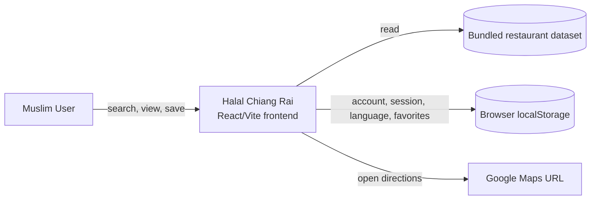
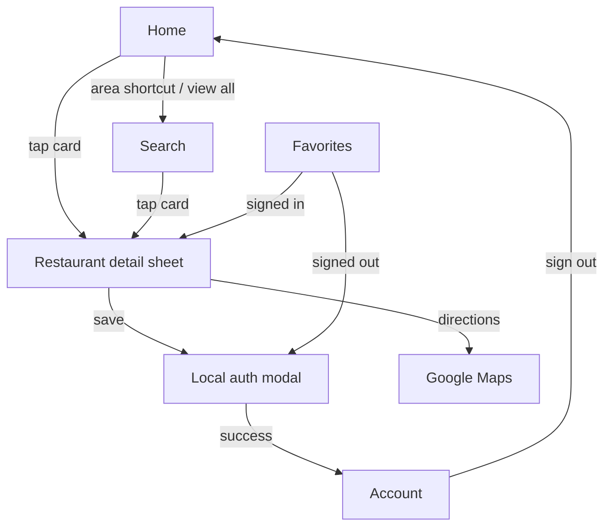
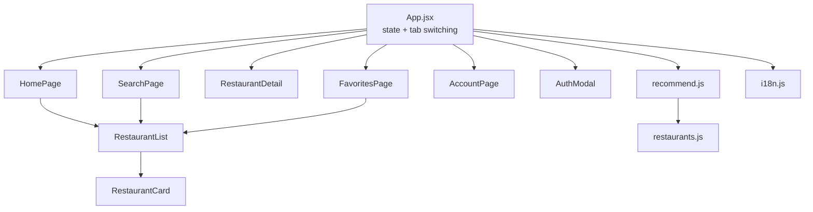
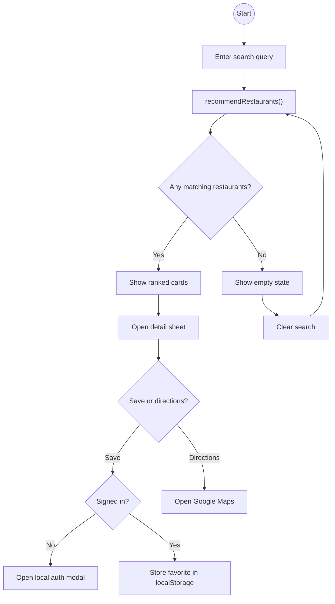

# Diagrams — Current Frontend Prototype

These diagrams describe the code that exists today. Backend, map, and
compliance services are shown as future boundaries rather than implemented
components.

## D1 — Current User Context

## D2 — Current UI Flow

## D3 — Current Component Architecture

## D4 — Search Activity

