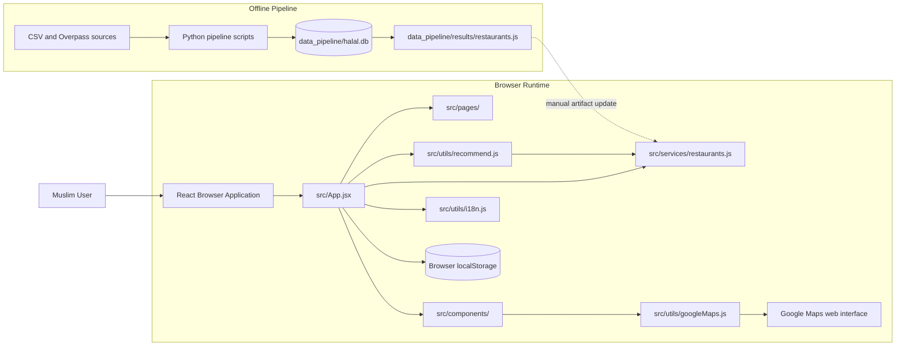
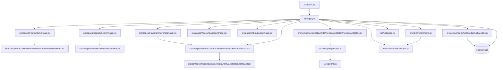
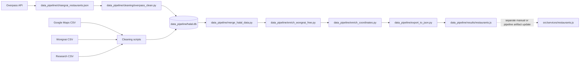
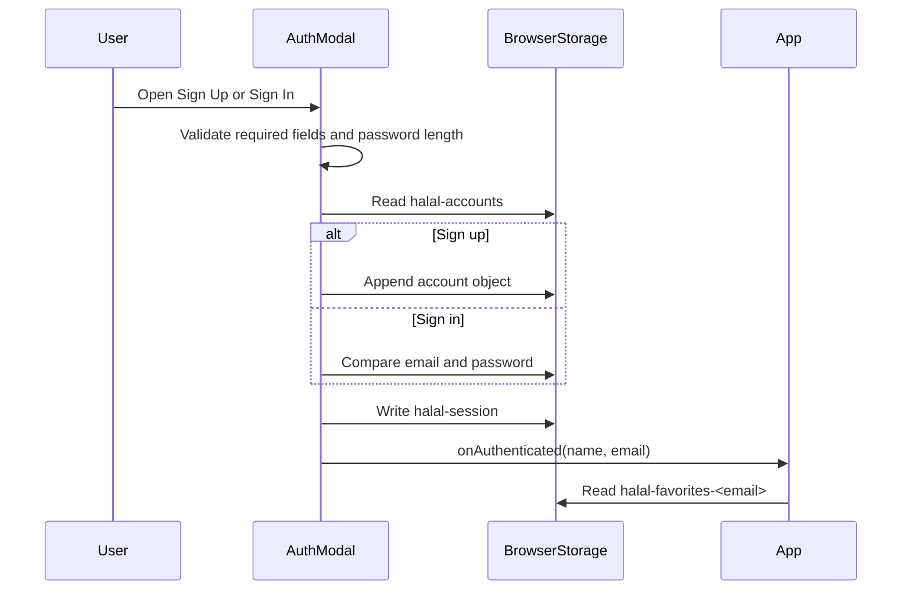
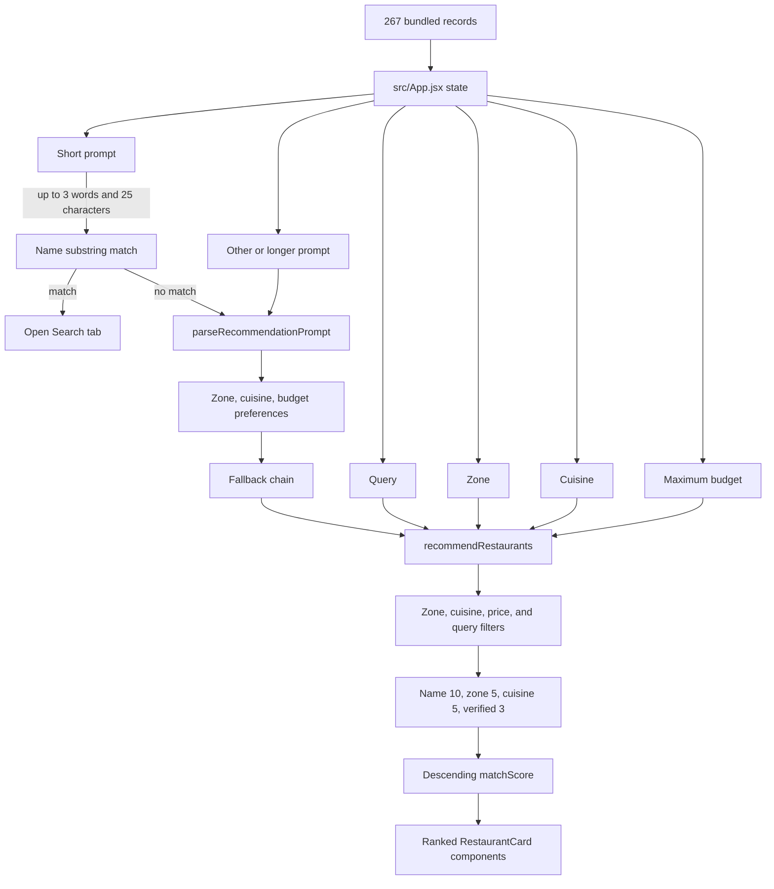

# System Architecture

## 1. Architecture Overview

Halal Chiang Rai is a mobile-first client-side React prototype. The browser
loads the bundled restaurant collection in
`src/services/restaurants.js`, applies local search and ranking in
`src/utils/recommend.js`, and stores prototype accounts, the active account,
favorites, and language preferences in `localStorage`.

The repository also contains an offline Python data pipeline. It reads source
files and external sources, creates or updates SQLite tables in
`data_pipeline/halal.db`, merges and enriches restaurant records, and exports
the result as a JavaScript module. The pipeline is separate from the browser
application and is not invoked by the Vite build or by a runtime API.

### Implemented browser runtime

- React application built and served with Vite.
- State and tab navigation managed in `src/App.jsx`.
- 267 bundled restaurant records.
- Deterministic, rule-based search and ranking.
- Browser-local prototype sign-in and sign-up.
- Browser-local favorite collections.
- Thai and English translations in `src/utils/i18n.js`.
- Google Maps directions or text search URLs.

### Planned or not implemented

- Backend HTTP server or REST API.
- PostgreSQL/PostGIS runtime access.
- Google OAuth.
- Server-side session management or secure password storage.
- Resend or SMTP/Mailpit email delivery.
- External LLM or generative AI provider.
- Live GPS or map rendering.
- Restaurant-owner, administrator, review, consent, or access-log workflows.

Names in `.env.example` are configuration placeholders only. They do not
demonstrate that PostgreSQL, OAuth, email, session, or LLM services are
integrated.

## 2. Architecture Diagram using Mermaid

### Browser data flow

### Offline pipeline flow

## 3. System Components and Responsibilities

| Component | Actual location | Responsibility | Status |
|---|---|---|---|
| React entry point | `src/main.jsx` | Creates the React root and renders `src/App.jsx`. | Implemented |
| Application state | `src/App.jsx` | Holds the active tab, search state, filters, account, favorites, language, and selected restaurant. | Implemented |
| Home page | `src/pages/Home/HomePage.jsx` | Renders the recommendation form, zone shortcuts, featured records, and list content. | Implemented |
| Local recommendation form | `src/components/AiRecommendForm/AiRecommendForm.jsx` | Accepts and submits prompt text; it contains no AI network logic. | Implemented UI over local logic |
| Search page | `src/pages/Search/SearchPage.jsx` | Renders `SearchBar` and result count. | Implemented |
| Search bar | `src/components/SearchBar/SearchBar.jsx` | Provides real-time input and clear/submit controls. | Implemented |
| Restaurant list | `src/components/restaurants/RestaurantList/RestaurantList.jsx` | Renders cards or an empty state. | Implemented |
| Restaurant card | `src/components/restaurants/RestaurantCard/RestaurantCard.jsx` | Displays summary fields and emits selection/favorite actions. | Implemented |
| Restaurant detail | `src/components/restaurants/RestaurantDetail/RestaurantDetail.jsx` | Displays detail fields, saves favorites, and opens Google Maps. | Implemented |
| Bottom navigation | `src/components/BottomNav/BottomNav.jsx` | Switches among Home, Search, Favorites, Account, and About views. | Implemented |
| Authentication modal | `src/components/AuthModal/AuthModal.jsx` | Performs browser-local sign-up and sign-in validation. | Prototype only |
| Restaurant dataset | `src/services/restaurants.js` | Exports 267 bundled JavaScript restaurant records. | Implemented |
| Search and ranking | `src/utils/recommend.js` | Normalizes text, filters records, scores matches, and sorts results. | Implemented |
| Localization | `src/utils/i18n.js` | Provides Thai/English values and translation helpers. | Implemented |
| Google Maps helper | `src/utils/googleMaps.js` | Builds coordinate or text-based Google Maps URLs and opens them. | Implemented |
| About, account, and favorites pages | `src/pages/About/`, `src/pages/Account/`, `src/pages/Favorites/` | Render static project, account, and saved-record views. | Implemented |
| Unused assistant component | `src/components/AiAssistantBox/AiAssistantBox.jsx` | Provides an AI-assistant UI surface but is not imported by `src/App.jsx` or the active page components. | Present but not wired |
| Pipeline runner | `data_pipeline/run_pipeline.py` | Runs offline acquisition, cleaning, merge, enrichment, and export scripts. | Implemented offline tooling |
| SQLite store | `data_pipeline/halal.db` | Stores source and merged tables for the offline pipeline. | Implemented offline only |
| Application backend | Not present | Would provide HTTP routes and server-side state. | Not implemented |

## 4. Frontend–Backend Communication

The frontend has no application backend communication.

- `src/App.jsx` directly imports `restaurants`, `cuisineTypes`, and `zones`
  from `src/services/restaurants.js`.
- `src/App.jsx` directly imports `parseRecommendationPrompt` and
  `recommendRestaurants` from `src/utils/recommend.js`.
- Account and favorite operations read or write `localStorage`; they do not call
  an authentication or user-data API.
- `src/components/restaurants/RestaurantDetail/RestaurantDetail.jsx` imports
  `openGoogleMaps` from `src/utils/googleMaps.js`.
- No browser `fetch`, Axios call, WebSocket, EventSource, `/api/*` route,
  Express server, or FastAPI application is present in `src/`.

No runtime API endpoints or backend URL contracts can be verified.

## 5. Database Architecture

### Browser runtime

PostgreSQL is not accessed in the React application. `package.json` contains
React, Vite, lucide-react, and their build dependencies only. `.env.example`
contains a `DATABASE_URL` placeholder, but no PostgreSQL driver or runtime
connection was found.

The runtime data source is the JavaScript export
`src/services/restaurants.js`. Confirmed representative fields include `id`,
`name`, `cuisine`, `rating`, `reviews`, `area`, `district`, `province`,
`priceRange`, `openingNote`, `latitude`, `longitude`, `halalStatus`,
`needsHalalCheck`, and `otherProvince`. The recommendation code also consumes
optional fields such as `minPrice`, `description`, `menu`, `verified`,
`zone`, `openingHours`, and `priceLevel`.

### Offline SQLite pipeline

`data_pipeline/halal.db` is accessed by Python scripts with `sqlite3`.
Confirmed tables and row counts are:

| Table | Role | Confirmed row count |
|---|---|---|
| `google_restaurants` | Cleaned Google source records | 94 |
| `overpass_restaurants` | Cleaned Overpass/OpenStreetMap records | 1 |
| `research_restaurants` | Cleaned research CSV records | 134 |
| `wongnai_restaurants` | Wongnai source records | 94 |
| `merged_restaurants_json` | Merged export table used by the JavaScript exporter | 267 |

SQLite access is implemented in:

- `data_pipeline/cleaning/db_utils.py`
- `data_pipeline/merge_halal_data.py`
- `data_pipeline/enrich_wongnai_free.py`
- `data_pipeline/enrich_coordinates.py`
- `data_pipeline/export_to_json.py`

The `merged_restaurants_json` table is the source for
`data_pipeline/results/restaurants.js`, which is a JavaScript export artifact,
not a live database connection.

No PostgreSQL/PostGIS schema, foreign-key relationships, or application
tables for users, favorites, reviews, consent, or access logs were found in
the confirmed implementation.

## 6. Authentication Flow

### Implemented prototype flow

Actual behavior:

- `halal-accounts` stores prototype account objects.
- `halal-session` stores the active account object.
- `halal-favorites-<email>` stores restaurant IDs.
- `halal-language` stores the selected language.
- Prototype passwords are retained as plain text in `localStorage`.
- Sign-out removes `halal-session`.
- No password hash, server session, cookie, expiry, authorization middleware,
  email verification, or account recovery exists.

### Google OAuth

Google OAuth is not implemented. `.env.example` declares Google OAuth variable
names, but `src/` contains no Google Identity SDK, redirect/callback handler,
token exchange, or OAuth-dependent route.

## 7. Restaurant Search and Recommendation Data Flow

### Search behavior

`src/utils/recommend.js` provides `recommendRestaurants()` and
`parseRecommendationPrompt()`.

The actual function:

- normalizes Unicode, whitespace, and case;
- derives MFU, MAESAI, CITY, and OTHER zones from restaurant location fields;
- filters zone and cuisine;
- parses the first numeric price from `priceRange`, or uses `minPrice`;
- rejects every record when `openNow` is true;
- tests query aliases and ordinary terms against restaurant name, location,
  cuisine, description, halal status, price range, and available menu names;
- scores name matches at 10 points, zone matches at 5, cuisine matches at 5,
  and verified records at 3;
- sorts records by descending `matchScore`.

`src/App.jsx` also checks short prompts for direct restaurant-name substrings.
For other prompts, `parseRecommendationPrompt()` recognizes supported Thai and
English zone, budget, and cuisine phrases. `applyRecommendation()` then tries
a fallback chain that progressively removes query, opening, amenities, and
zone constraints.

### Recommendation limitations

- There is no external AI or LLM call.
- The UI is named “AI,” but behavior is deterministic local parsing.
- `openNow` is not implemented: it makes `recommendRestaurants()` return no
  matches.
- `halalOnly` is not a confirmed filter in `recommendRestaurants()`.
- `requiredAmenities` is not implemented in `recommendRestaurants()`.
- Opening hours are generated locally in `src/utils/recommend.js` rather than
  read directly from every source record.
- The fallback parser supports only its coded aliases and budget patterns.
- Restaurant verification and halal status require source review.

## 8. External Services and Integrations

### Implemented external use

| Integration | Actual use | Location |
|---|---|---|
| Google Maps web interface | Opens directions or search URLs from coordinates or address fields. No embedded map or API key is used. | `src/utils/googleMaps.js` |
| Overpass API | Offline HTTP POST used to collect restaurant records. | `data_pipeline/getData.py` |
| Nominatim/Geopy | Offline geocoding and reverse geocoding. | `data_pipeline/enrich_coordinates.py` |
| Wongnai website | Offline HTTP requests and JSON-LD extraction for price, opening hours, and coordinates. | `data_pipeline/enrich_wongnai_free.py` |

### Not integrated

| Potential integration | Verification result |
|---|---|
| Google OAuth | Placeholder variables only. |
| PostgreSQL/PostGIS | Placeholder `DATABASE_URL` only. |
| Resend | Placeholder variables only. |
| Mailpit/SMTP | Placeholder variables only. |
| External LLM | Placeholder variables only; no SDK or network call found. |
| Browser GPS | No Geolocation API use found. |
| Embedded maps | No map SDK or map component found. |

The current localization text mentions a Gemini fallback in
`src/utils/i18n.js`, but that text is not evidence of a Gemini integration.
The current source contains no Gemini or other LLM call.

## 9. Deployment Architecture

The repository verifies only local Vite development and static build output:

- `npm run dev` starts the Vite development server.
- `npm run build` produces `dist/`.
- `npm run preview` serves the generated static build locally.

No Dockerfile, Compose file, CI workflow, hosting configuration,
infrastructure-as-code, reverse proxy, domain, CDN, or production topology
was found. Production deployment cannot be confirmed.

The offline pipeline is not a package script and is not integrated into the
Vite build.

## 10. Technical Limitations

- Accounts and favorites are isolated to one browser profile.
- Prototype passwords are stored as plain text.
- Browser sessions can be modified or cleared and have no server validation.
- The bundled dataset can become stale without an exported pipeline refresh.
- Offline pipeline exports are not automatically synchronized with the
  frontend.
- Field shapes differ across source records and the bundled JavaScript export.
- Opening-now and amenity filtering are incomplete.
- External scraping depends on source availability and webpage structures.
- No automated test runner is configured.
- Consent, access-log, certificate, review, and owner/admin workflows are
  absent.
- A server authorization and retention boundary does not exist.

## Verification Summary

Confirmed:

- `src/App.jsx` is the active application state layer.
- `src/services/restaurants.js` exports 267 records.
- `src/utils/recommend.js` implements local search and ranking.
- `src/utils/googleMaps.js` is the actual Google Maps integration.
- `src/utils/i18n.js` is the localization module.
- The SQLite database has the five tables and row counts documented above.
- The complete active component paths are under `src/pages/` and
  `src/components/`.

Could not be confirmed:

- Backend APIs or API routes.
- PostgreSQL/PostGIS runtime access.
- Google OAuth.
- Server-side sessions.
- Email delivery.
- External LLM calls.
- Live location or embedded mapping.
- Production hosting topology.
