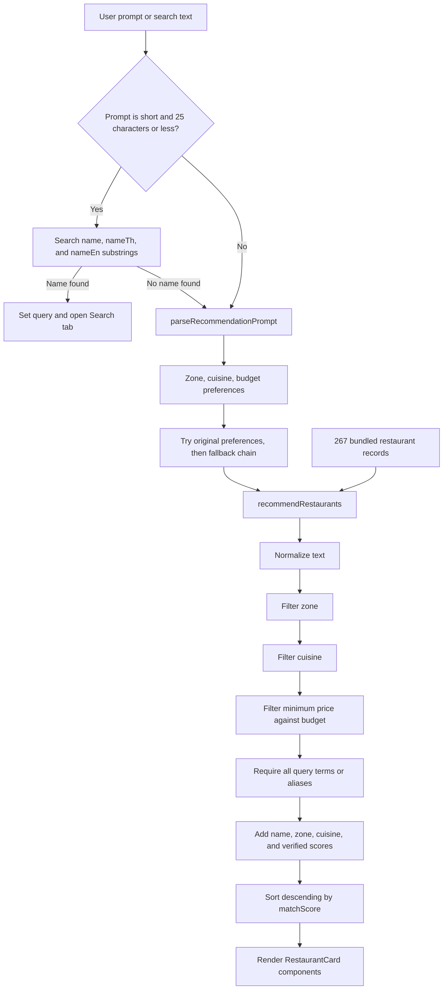

# AI Logic — Halal Chiang Rai

## 1. Overview

The current recommendation functionality is deterministic, rule-based
keyword and filter logic. It is implemented in the browser and does not use a
trained machine learning model or an external LLM.

The application uses:

- a bundled JavaScript restaurant dataset;
- text normalization and alias matching;
- zone, cuisine, and budget filters;
- fixed score increments;
- a sorted result list;
- a prompt parser for supported Thai and English phrases.

The user interface labels this feature as “AI,” and localization text mentions
Gemini, but the actual source contains no Gemini SDK call, LLM HTTP request,
prompt payload, or model response handler. `.env.example` contains LLM variable
names, but those declarations are placeholders rather than implementation
evidence.

## 2. Where: Codebase and Components

| Component | Location | Responsibility | Connection |
|---|---|---|---|
| Restaurant dataset | `src/services/restaurants.js` | Exports 267 bundled restaurant records | Imported directly by `src/App.jsx` and `src/utils/recommend.js` |
| Application state and orchestration | `src/App.jsx` | Holds `query`, `zone`, `cuisine`, `budget`, `aiPrompt`, and extra preferences; invokes parsing and recommendation | Calls `parseRecommendationPrompt()` and `recommendRestaurants()`; passes filtered results to pages and components |
| Recommendation parser | `src/utils/recommend.js` | Exports `parseRecommendationPrompt(prompt)` | Parses area, cuisine, and budget phrases for `applyRecommendation()` |
| Recommender | `src/utils/recommend.js` | Exports `recommendRestaurants(restaurants, preferences)` | Filters, derives display fields, scores, and sorts records |
| Home prompt UI | `src/pages/Home/HomePage.jsx` | Renders the Home experience and recommendation form | Passes prompt callbacks and area actions to `AiRecommendForm` |
| Prompt form | `src/components/AiRecommendForm/AiRecommendForm.jsx` | Accepts prompt input and submits it | Calls `onAiRecommend(aiPrompt)` provided by `src/App.jsx` |
| Search UI | `src/pages/Search/SearchPage.jsx` | Renders the query field, result count, and result list | Receives the live `query` state and filtered `children` from `src/App.jsx` |
| Search field | `src/components/SearchBar/SearchBar.jsx` | Updates the query value | Calls `onChange` for `src/App.jsx` |
| Restaurant list | `src/components/restaurants/RestaurantList/RestaurantList.jsx` | Renders ranked cards or an empty state | Receives `filteredRestaurants` or `featuredRestaurants` from `src/App.jsx` |
| Restaurant card | `src/components/restaurants/RestaurantCard/RestaurantCard.jsx` | Displays a result and opens details | Receives a transformed restaurant record from `src/utils/recommend.js` |
| Localization | `src/utils/i18n.js` | Provides Thai/English UI text | Supplies labels including UI text for the recommendation form |
| Google Maps helper | `src/utils/googleMaps.js` | Generates navigation URLs | Related to result details, but not used by recommendation scoring |

### Dataset structure

`src/services/restaurants.js` exports an array named `restaurants`. The
representative application fields are:

```text
id
name
cuisine
rating
reviews
area
district
province
priceRange
openingNote
latitude
longitude
halalStatus
needsHalalCheck
otherProvince
```

The recommender may add derived fields:

```text
zone
district
cuisine
priceLevel
openingHours
matchScore
```

The export contains 267 records.

### External AI/LLM status

No external AI or LLM integration is implemented:

- no LLM package is declared;
- no `fetch`, Axios, WebSocket, or model SDK call is present in `src/`;
- no model response parsing exists;
- no embedding or vector search exists;
- no Gemini, OpenAI, or other provider call was found;
- `CLOUD_LLM_API_KEY` and `CLOUD_LLM_MODEL` in `.env.example` are not runtime
  integrations.

## 3. How: Recommendation Workflow



### Step 1: Input

The Home prompt is submitted by `AiRecommendForm`, which calls
`onAiRecommend(aiPrompt)`. The normal Search page updates `query` directly
through `onChange`.

### Step 2: Short-name fast path

In `src/App.jsx`, `handleAiRecommend()` trims the prompt and sets
`aiPrompt`.

If the prompt contains at most three whitespace-separated words and is 25
characters or fewer, the app searches:

- `restaurant.name`
- `restaurant.nameTh`
- `restaurant.nameEn`

for a case-insensitive substring match. If a match exists, the app sets the
query to the prompt, sets the zone to `ALL`, resets cuisine to `ทั้งหมด`,
sets budget to `2000`, clears extra preferences, and opens Search.

### Step 3: Prompt preprocessing

`parseRecommendationPrompt()` uses `normalize()` to:

- convert values to strings;
- apply Unicode NFC normalization;
- convert to a lowercase locale form;
- collapse whitespace;
- trim the result.

The parser uses regular expressions to detect:

- MFU, Mae Sai, Chiang Rai city, or other district terms;
- budget phrases;
- cuisine aliases.

Budget detection recognizes patterns including:

- `ไม่เกิน`, `ต่ำกว่า`, `น้อยกว่า`;
- `งบ`;
- `under`, `below`, `budget`;
- `฿`;
- values ending in `บาท` or `baht`.

### Step 4: Preference construction

`applyRecommendation()` in `src/App.jsx` validates the parser's zone and cuisine
against `zones` and `cuisineTypes`. It clamps the parsed budget to 50–2000 and
constructs preferences including:

```text
query
zone
cuisine
maxBudget
openNow
halalOnly
requiredAmenities
```

The application then tries a fallback chain that removes or relaxes
`openNow`, `requiredAmenities`, query, budget, and zone constraints.

### Step 5: Filtering

`recommendRestaurants()` applies filters in this order:

1. Derive zone from province, area, district, and name.
2. Filter zone unless it is `ALL`.
3. Match cuisine aliases.
4. Compare the first numeric price in `priceRange`, or `minPrice`, against
   `maxBudget`.
5. If `includeUnverified` is false, require `restaurant.verified`.
6. Reject all records if `openNow` is true.
7. Require every query term or alias to occur in searchable text.

The searchable text combines:

- name;
- district;
- area;
- province;
- zone;
- cuisine;
- description;
- price range;
- halal status;
- menu item names, when present.

### Step 6: Scoring

Each matching record receives:

- 10 points for each query term found in `restaurant.name`;
- 5 points when it matches the selected zone;
- 5 points when it matches the selected cuisine;
- 3 points when `restaurant.verified` is true.

The function then:

```text
map record -> add zone, district, cuisine, priceLevel,
             generated openingHours, and matchScore
sort by matchScore descending
```

Opening hours are not consistently read from source fields. In
`getOpeningHours()`, a deterministic sequence based on restaurant ID generates
a time range.

### Step 7: Result generation and display

The transformed sorted records are passed to `RestaurantList`, then rendered
as `RestaurantCard` components. The Home list uses a featured subset; the
Search and prompt flows use the live filtered result.

### Incomplete or unused parameters

The following parameters are passed or constructed but not used for real
recommendation behavior:

| Parameter | Implementation behavior |
|---|---|
| `openNow` | If true, the filter explicitly rejects every record. It does not implement live opening-time logic. |
| `halalOnly` | It is accepted in no confirmed recommender signature and is not used by `recommendRestaurants()`. |
| `requiredAmenities` | It is carried by `src/App.jsx` but is not used by `recommendRestaurants()`. |
| `keyword` | `applyRecommendation()` creates `query: preferences.keyword`, but `parseRecommendationPrompt()` currently does not set `preferences.keyword`. |
| `includeUnverified` | Supported in the recommender, but the UI does not expose a testable control that sets it false. |

## 4. Prove: Testing and Evidence

### Existing evidence

The repository contains:

- `test/unit/recommend.test.js`, currently located under
  `.docs/design/test/unit/recommend.test.js`;
- component tests under `.docs/design/test/unit/`;
- `.docs/design/test/testing-report.md`.

The existing testing report states that 17 tests passed previously. This
evidence is historical and the test files are currently not reproducible by
`npm test` because they reference a missing `test/setup.js`.

An actual run on 2026-11-21 produced:

```text
Test Files  4 failed (4)
Tests       no tests
Error: Cannot find module '/workspaces/MuslimRestaurantProject/test/setup.js'
```

Therefore, the historical 17-pass report is not accepted here as current
execution evidence.

### Test Set

The following executed test set is defined in
`scripts/evaluate-recommendations.mjs` and is labeled as executed because the
script was run against the actual repository.

| Test ID | Input | Expected behavior | Actual result | Status |
|---|---|---|---|---|
| AI-NAME-786 | Query `786` | Return `786 Islamic Restaurant` | 3 records; expected name included | PASS |
| AI-AREA-MAESAI-TH | Query `แม่สาย` | Return Mae Sai matches | 28 records | PASS |
| AI-AREA-MAESAI-EN | Zone `MAESAI` | Return Mae Sai matches | 28 records | PASS |
| AI-CATEGORY-EN | Query `coffee` | Return nonempty café matches | 7 records | PASS |
| AI-CATEGORY-TH | Query `ฮาลาล` | Return nonempty Halal matches | 139 records | PASS |
| AI-MULTI | Mae Sai + café + budget `200` | Return matching records | 4 records | PASS |
| AI-NOMATCH | Query `zzzz-no-match` | Return no records | 0 records | PASS |
| AI-EMPTY | Empty query, all zones, budget 2000 | Return all 267 records | 267 records | PASS |
| AI-OPENNOW | `openNow: true` | Document existing behavior | 0 records | PASS as limitation check |
| AI-HALALONLY | `halalOnly: true` | Document that it is unused | 267 records | PASS as limitation check |

Additional proposed test cases exist but were not executed:

**Proposed Test Set — Not Yet Executed**

- Thai restaurant-name search.
- English location alias `mueang chiang rai`.
- Budget below minimum value.
- Cuisine with no matching records.
- Unicode NFC normalization variants.
- `requiredAmenities` containing supported and unsupported values.
- `includeUnverified: false` with a relevance-labeled dataset.
- UI search and favorite interactions after page reload.
- Large or repeated query performance.

### Baseline

An appropriate baseline is a basic substring search that concatenates
restaurant name, district, area, cuisine, and description and tests whether the
raw query is included.

No prior baseline implementation or baseline comparison was recorded before
this evaluation. This script executes the proposed baseline for cases with
query text. It is not a trained or historical production baseline.

The baseline should be reproduced with:

```bash
node scripts/evaluate-recommendations.mjs
```

The executed baseline produced `5/5` successful expectation checks.

### Evaluation Script

The reproducible script is:

- `scripts/evaluate-recommendations.mjs`

It:

- loads `src/services/restaurants.js`;
- imports `recommendRestaurants()` and `parseRecommendationPrompt()`;
- runs the executed test set;
- records the result count and pass/fail status;
- calculates success, empty-result, average response, and P95 response metrics;
- runs a basic substring baseline for query-based cases;
- prints Thai and English parser outputs;
- explicitly reports that Precision@K and Recall@K are unavailable.

### Test Results / Logs

Executed on 2026-11-21:

```text
Dataset size: 267

AI-NAME-786: returned=3, PASS
AI-AREA-MAESAI-TH: returned=28, PASS
AI-AREA-MAESAI-EN: returned=28, PASS
AI-CATEGORY-EN: returned=7, PASS
AI-CATEGORY-TH: returned=139, PASS
AI-MULTI: returned=4, PASS
AI-NOMATCH: returned=0, PASS
AI-EMPTY: returned=267, PASS
AI-OPENNOW: returned=0, PASS
AI-HALALONLY: returned=267, PASS

Success/expectation rate: 10/10 (100%)
Empty result rate: 2/10 (20%)
Average response time: 2.235 ms
P95 response time: 4.329 ms

Basic-substring baseline: 5/5
```

Response-time values are environment-specific Node.js measurements and should
not be interpreted as browser rendering time or network latency.

## 5. Measure: Evaluation Metrics

| Metric | Formula | Required data | Collection method | Meaning |
|---|---|---|---|---|
| Success/expectation rate | Passed expectation checks / executed checks | Human-defined expected behavior | Evaluation script | Checks whether known queries meet the recorded expectation |
| Empty result rate | Queries returning zero / executed queries | Query and returned result count | Evaluation script | Measures how often the algorithm produces no candidate |
| Response time | Time before/after `recommendRestaurants()` | Timestamp in the Node process | `performance.now()` | Measures in-process algorithm execution, not UI latency |
| P95 response time | 95th percentile of measured durations | Repeated result durations | Evaluation script | Shows a higher-end duration without the mean alone |
| Precision@K | Relevant items in top K / K | Relevance labels and K | Requires labeled query relevance judgments | Measures ranking accuracy at a cutoff |
| Recall@K | Relevant items in top K / total relevant items | Relevance labels and complete relevant set | Requires labeled query relevance judgments | Measures whether relevant items are omitted |

No Precision@K or Recall@K value was calculated because the repository does not
contain an approved ground-truth relevance set. Without relevance labels,
counts such as a 139-result “ฮาลาล” query cannot prove ranking quality.

To enable reliable relevance metrics:

1. Define a set of representative Thai and English queries.
2. Independently identify relevant restaurant records for each query.
3. Grade each result as relevant or irrelevant.
4. Store query, record ID, relevance label, and evaluator.
5. Run Precision@K and Recall@K with an agreed cutoff, such as K = 5 or K = 10.
6. Separate subjective category matches from authoritative Halal-status facts.

## 6. Limitations

### Current rule-based limitations

- Query matching is string-based and sensitive to unsupported wording.
- Thai and English aliases cover only coded expressions.
- Scoring is fixed and has no learned personalization.
- Name substring and alias matching can create false positives.
- Multi-condition matching requires all normalized query terms to occur.
- Budget filtering depends on `minPrice` or a numeric string in `priceRange`.
- The generated opening-hours implementation is an ID sequence, not confirmed
  real opening information.
- `openNow: true` rejects all records.
- `halalOnly` is not implemented.
- `requiredAmenities` is not implemented.
- `halalStatus` and verification fields are not official certification evidence.
- Dataset coverage and freshness cannot be confirmed from the frontend alone.
- No user feedback, click data, favorites-by-query data, or relevance labels
  are collected.

### Test infrastructure limitations

- The existing JavaScript test suite currently fails before running because
  `vite.config.js` expects `./test/setup.js`, while the active test files and
  setup location are no longer at that path.
- Existing test reports describe earlier passed runs, but current execution
  evidence supersedes those historical claims.
- No browser automation or network-level evaluation is included.

## 7. Future Improvements

Future work could include:

- repairing test setup paths and restoring a reproducible Vitest suite;
- recording independent relevance labels for named, location, category, and
  multi-condition queries;
- implementing live opening-hours parsing and an actual `openNow` filter;
- implementing `halalOnly` from verified source fields;
- defining and validating amenity fields before adding `requiredAmenities`;
- using explicit district and cuisine fields instead of broad text matching;
- normalizing Thai text beyond NFC, including approved synonyms;
- introducing bounded fuzzy matching;
- collecting user feedback and anonymized interaction outcomes;
- adding API latency and UI rendering measurements if a backend is introduced;
- considering an external LLM only after privacy review, fallback design,
  ground-truth labeling, and explicit integration.

A future ML or LLM system should remain behind an evaluation gate and be
compared with this rule-based implementation using the same relevance labels,
response latency, empty-result rate, and user satisfaction measures.

## 8. Reproducibility: How to Run the Evaluation

Run the standalone evaluation from the repository root:

```bash
node scripts/evaluate-recommendations.mjs
```

The script uses Node.js built-in modules and imports the existing source
dataset and recommender. It does not require environment variables or external
network access.

To check the React test command:

```bash
npm test -- --reporter=dot
```

As of the latest execution, this command fails at suite setup because
`vite.config.js` references `test/setup.js`, which is not currently present.
This is a test-infrastructure issue, not a passing or failing recommendation
algorithm result.
