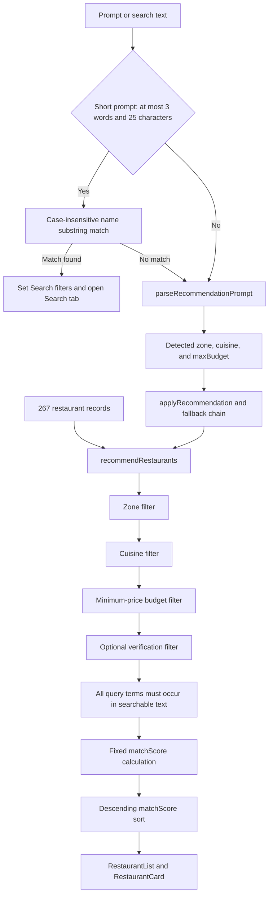

# AI Logic - Halal Chiang Rai

## 1. Overview

Halal Chiang Rai currently uses deterministic, rule-based search and recommendation logic. It does not use a trained machine-learning model or an external AI/LLM API in the application implementation.

The system combines:

- normalization and alias matching for Thai and English text;
- geographic zone filtering;
- cuisine matching;
- a minimum-price budget filter;
- fixed scoring based on name, zone, cuisine, and verification status;
- deterministic sorting by descending score;
- an optional prompt parser for natural-language filters.

The UI calls this feature “AI,” and [src/utils/i18n.js](/workspaces/MuslimRestaurantProject/src/utils/i18n.js) contains text that mentions Gemini fallback behavior. However, the source code does not contain a Gemini SDK call, HTTP request, model prompt, or response parser. [.env.example](/workspaces/MuslimRestaurantProject/.env.example) declares `CLOUD_LLM_API_KEY` and `CLOUD_LLM_MODEL`, but these are configuration placeholders and are not runtime integrations.

## 2. Where: Codebase and Components

| Component | File path | Main responsibility | Connections |
|---|---|---|---|
| Restaurant dataset | [src/services/restaurants.js](/workspaces/MuslimRestaurantProject/src/services/restaurants.js) | Exports the `restaurants`, `zones`, and `cuisineTypes` values | Imported by `src/App.jsx`, `src/utils/recommend.js`, tests, and the evaluation script |
| Application orchestration | [src/App.jsx](/workspaces/MuslimRestaurantProject/src/App.jsx) | Stores search/filter state, parses prompts, selects fallback preferences, and switches to the Search tab | Calls `parseRecommendationPrompt()` and `recommendRestaurants()` |
| Rule-based recommender | [src/utils/recommend.js](/workspaces/MuslimRestaurantProject/src/utils/recommend.js) | Normalizes queries, filters records, calculates `matchScore`, derives display fields, and sorts results | Imported by `src/App.jsx` and the evaluation script |
| Home prompt UI | [src/components/AiRecommendForm/AiRecommendForm.jsx](/workspaces/MuslimRestaurantProject/src/components/AiRecommendForm/AiRecommendForm.jsx) | Accepts a text prompt and calls `onAiRecommend` | Receives callbacks from `src/App.jsx` through `src/pages/Home/HomePage.jsx` |
| Home page | [src/pages/Home/HomePage.jsx](/workspaces/MuslimRestaurantProject/src/pages/Home/HomePage.jsx) | Renders the prompt form, area shortcuts, and restaurant results | Hosts `AiRecommendForm` and `RestaurantList` |
| Search page | [src/pages/Search/SearchPage.jsx](/workspaces/MuslimRestaurantProject/src/pages/Search/SearchPage.jsx) | Renders the search field and live result count | Receives `filteredRestaurants` from `src/App.jsx` |
| Search field | [src/components/SearchBar/SearchBar.jsx](/workspaces/MuslimRestaurantProject/src/components/SearchBar/SearchBar.jsx) | Updates the `query` state during typing | Calls `onChange` provided by `src/App.jsx` |
| Restaurant rendering | [src/components/restaurants/RestaurantList/RestaurantList.jsx](/workspaces/MuslimRestaurantProject/src/components/restaurants/RestaurantList/RestaurantList.jsx) | Renders the ranked restaurant cards or reset/empty state | Receives `recommendRestaurants()` output |
| Restaurant card | [src/components/restaurants/RestaurantCard/RestaurantCard.jsx](/workspaces/MuslimRestaurantProject/src/components/restaurants/RestaurantCard/RestaurantCard.jsx) | Displays a result and forwards selection/favorite actions | Receives a transformed restaurant record |
| Localization | [src/utils/i18n.js](/workspaces/MuslimRestaurantProject/src/utils/i18n.js) | Supplies Thai/English labels and AI-related text | Used by UI components |
| Evaluation script | [scripts/evaluate-recommendations.mjs](/workspaces/MuslimRestaurantProject/scripts/evaluate-recommendations.mjs) | Executes ten repository-defined checks and a simple baseline | Imports the actual dataset and recommender |
| Recommendation unit tests | [.docs/design/test/unit/recommend.test.js](/workspaces/MuslimRestaurantProject/.docs/design/test/unit/recommend.test.js) | Defines Vitest checks for dataset size, name, zone, price, parsing, and `openNow` behavior | Imports `src/services/restaurants.js` and `src/utils/recommend.js` |

### Restaurant Dataset

The dataset is exported directly from `src/services/restaurants.js` as the `restaurants` array. It contains 267 records. Representative fields are:

```text
id
name
cuisine
rating
reviews
area
district
province
priceRange
openingNote
latitude
longitude
halalStatus
needsHalalCheck
otherProvince
verified
minPrice
menu
```

Not every field is present in every record. The recommender derives `zone`, `district`, `cuisine`, `priceLevel`, `openingHours`, and `matchScore` for display and ranking.

### External AI/LLM Status

No external AI or LLM integration is confirmed:

- no LLM SDK dependency is declared in `package.json`;
- no `fetch` or model API call for recommendation is present in `src/`;
- no embedding, vector index, or trained model is present;
- no model response is parsed;
- the Cloud LLM environment names are placeholders in `.env.example`;
- “Gemini” appears in localization text only.

## 3. How: Recommendation Workflow



### User input and preprocessing

`AiRecommendForm.submitRecommendation()` rejects blank prompts and sends `aiPrompt` to `App.handleAiRecommend()`. The normal Search page updates `query` directly with `SearchBar`.

`normalize()` in `src/utils/recommend.js` converts a value to a string, applies NFC normalization, lowercases it, collapses whitespace, and trims it.

### Short-name fast path

`App.handleAiRecommend()` performs a short-name check before prompt parsing. If the prompt has no more than three whitespace-separated words and no more than 25 characters, it checks whether the prompt is a case-insensitive substring of `name`, `nameTh`, or `nameEn`.

If a match is found, the app sets `zone = "ALL"`, `cuisine = "ทั้งหมด"`, `budget = 2000`, clears extra preferences, and opens Search. This bypasses `parseRecommendationPrompt()`.

### Intent and preference parsing

`parseRecommendationPrompt()` uses regular expressions to detect:

- `MFU`, Mae Sai, Chiang Rai City, or another-district locations;
- budgets using Thai or English terms such as `ไม่เกิน`, `under`, `below`, `฿`, `บาท`, or `baht`;
- café, noodle, dessert, roti, Thai, local, Arabic, Indian, Malaysian, and Halal cuisine aliases.

The parser returns a preference object containing fields such as `zone`, `maxBudget`, and `cuisine`.

`App.applyRecommendation()` validates the parsed zone and cuisine against exported values and clamps the budget to 50–2000. It constructs a candidate preference object and then tries a fallback chain that progressively relaxes:

1. `openNow`;
2. `requiredAmenities`;
3. the original query;
4. the budget;
5. the zone.

The first candidate producing at least one restaurant is applied.

### Filtering

`recommendRestaurants(restaurants, preferences)` derives a restaurant zone using province, area, district, and name text. It can return `MFU`, `MAESAI`, `CITY`, `OTHER`, or `null`.

The filter requires:

1. the selected zone, unless `zone === "ALL"`;
2. a cuisine alias match, unless cuisine is `ทั้งหมด`;
3. `minPrice <= maxBudget`, or the first numeric value in `priceRange <= maxBudget`;
4. verification only if `includeUnverified === false`;
5. every normalized query term or alias to occur in the searchable text.

The searchable text combines name, district, area, province, zone, cuisine, description, price range, Halal status, and menu item names.

### Scoring and ranking

The implementation adds a fixed score:

- 10 points for every query term found in the restaurant name;
- 5 points for a matching selected zone;
- 5 points for a matching selected cuisine;
- 3 points if `restaurant.verified` is true.

Pseudo-code:

```text
score = 0
for each query term:
    if term occurs in normalized restaurant name:
        score += 10
if selected zone matches:
    score += 5
if selected cuisine matches:
    score += 5
if restaurant is verified:
    score += 3
sort descending by score
```

The function also assigns a derived opening-hours string. `getOpeningHours()` is calculated from restaurant ID and is not a confirmed source of real opening information.

### Result generation

The sorted records are passed to `RestaurantList`, which renders `RestaurantCard` components or an empty/reset state. The normal Search page is updated with the live filtered result count.

### Passed but unused or incomplete parameters

| Parameter | Actual behavior |
|---|---|
| `openNow` | `true` rejects every restaurant. It does not parse or compare real opening hours. |
| `halalOnly` | Passed by `App.applyRecommendation()`, but ignored by `recommendRestaurants()`. |
| `requiredAmenities` | Passed through UI state, but ignored by `recommendRestaurants()`. |
| `keyword` | `applyRecommendation()` reads `preferences.keyword`, but `parseRecommendationPrompt()` does not set `keyword`; it therefore does not supply the original prompt to this field. |
| `includeUnverified` | Supported by `recommendRestaurants()`, but no UI control currently sets it to `false`. |

## 4. Prove: Testing and Evidence

### Test Set

#### Implemented and Executed Test Set

The standalone evaluation script contains ten repository-defined cases and was executed at 06:10 UTC on 2026-11-22.

| Test ID | Input | Expected behavior | Actual result | Status |
|---|---|---|---|---|
| AI-NAME-786 | `query = "786"` | Return a restaurant named `786 Islamic Restaurant` | 3 records; expected name included | PASS |
| AI-AREA-MAESAI-TH | `query = "แม่สาย"` | Return Mae Sai matches | 28 records | PASS |
| AI-AREA-MAESAI-EN | `zone = "MAESAI"` | Return Mae Sai matches | 28 records | PASS |
| AI-CATEGORY-EN | `query = "coffee"` | Return café matches | 7 records | PASS |
| AI-CATEGORY-TH | `query = "ฮาลาล"` | Return Halal-category matches | 139 records | PASS |
| AI-MULTI | Mae Sai + café + budget 200 | Return matching records | 4 records | PASS |
| AI-NOMATCH | `query = "zzzz-no-match"` | Return no records | 0 records | PASS |
| AI-EMPTY | Empty query with all zones and budget 2000 | Return all 267 records | 267 records | PASS |
| AI-OPENNOW | `openNow = true` | Existing behavior is that no records match | 0 records | PASS as limitation check |
| AI-HALALONLY | `halalOnly = true` | Existing behavior is that it is ignored | 267 records | PASS as limitation check |

The Vitest unit test file contains additional focused cases for:

- exporting 267 records;
- an empty query;
- English/numeric name matching;
- Thai and English Mae Sai matching;
- `openNow`;
- Thai and English prompt parsing;
- `minPrice` budget filtering.

#### Proposed Test Set - Not Yet Executed

The following cases are proposed for additional coverage:

- Thai restaurant-name search;
- `mueang chiang rai` and other location aliases;
- a budget below the dataset minimum;
- cuisine with no matches;
- Unicode normalization variants;
- `requiredAmenities` values;
- `includeUnverified = false`;
- prompt fallback and UI behavior;
- repeated query performance.

These cases are not claimed as passing until executed.

### Baseline

The implemented script uses a basic substring baseline. It checks whether the raw normalized query occurs in restaurant name, district, area, cuisine, or description.

The baseline was executed by [scripts/evaluate-recommendations.mjs](/workspaces/MuslimRestaurantProject/scripts/evaluate-recommendations.mjs) against the five baseline-capable query cases. It produced 5/5 successful expectation checks. This is a simple comparison method, not a production baseline recorded before the recommender.

To reproduce:

```bash
node scripts/evaluate-recommendations.mjs
```

### Evaluation Script

The evaluation script:

- imports the 267-record bundled dataset;
- imports `recommendRestaurants()` and `parseRecommendationPrompt()`;
- runs ten deterministic cases;
- times each recommender call with `performance.now()`;
- calculates success, empty-result, average, and P95 metrics;
- executes and compares the basic substring baseline;
- prints Thai and English parser outputs;
- states that Precision@K and Recall@K are unavailable without relevance labels.

### Test Results / Logs

The standalone evaluation produced:

```text
Dataset size: 267

AI-NAME-786: returned=3, PASS
AI-AREA-MAESAI-TH: returned=28, PASS
AI-AREA-MAESAI-EN: returned=28, PASS
AI-CATEGORY-EN: returned=7, PASS
AI-CATEGORY-TH: returned=139, PASS
AI-MULTI: returned=4, PASS
AI-NOMATCH: returned=0, PASS
AI-EMPTY: returned=267, PASS
AI-OPENNOW: returned=0, PASS
AI-HALALONLY: returned=267, PASS

Success/expectation rate: 10/10 (100.00%)
Empty result rate: 2/10 (20.00%)
Average response time: 2.235 ms
P95 response time: 4.210 ms

Basic-substring baseline: 5/5
```

The timing values are Node.js in-process measurements; they do not measure browser rendering or network latency.

The existing npm test command was also executed:

```bash
npm test -- --reporter=dot
```

It failed before running tests because `vite.config.js` references `test/setup.js`, but that file does not exist. All four discovered suites failed at setup, and no Vitest tests executed.

## 5. Measure: Evaluation Metrics

| Metric | Formula | Required data | Collection | Meaning |
|---|---|---|---|---|
| Success/expectation rate | Passed checks / executed checks | Explicit expected behavior | Evaluation script | Measures agreement with known deterministic expectations |
| Empty result rate | Queries with zero results / executed queries | Returned result count | Evaluation script | Measures how often the system provides no candidate |
| Average response time | Sum of durations / number of calls | Recommender call timestamps | `performance.now()` | Measures local Node.js recommender execution |
| P95 response time | 95th percentile of measured durations | Repeated call durations | Evaluation script | Shows a higher-end duration |
| Precision@K | Relevant records in top K / K | Independent relevance judgments | Not currently calculated | Would measure ranking accuracy at a cutoff |
| Recall@K | Relevant records in top K / total relevant records | Relevance judgments and complete relevant set | Not currently calculated | Would measure whether relevant records are omitted |

Precision@K and Recall@K cannot be calculated reliably from the current repository. The number of matches for a query is not, by itself, evidence of relevance. Approval or certification ground truth is also not confirmed from the bundled fields.

To collect labels:

1. define representative Thai and English queries;
2. assign result relevance independently of the query author;
3. distinguish category relevance from Halal-status certification evidence;
4. store restaurant ID, query, relevance label, evaluator, and label date;
5. calculate Precision@K and Recall@K using an agreed cutoff such as 5 or 10.

## 6. Limitations

Current limitations include:

- string matching is sensitive to unsupported wording and spelling;
- Thai and English aliases cover only coded phrases;
- fixed 10/5/5/3 scoring is not personalized or learned;
- exact-term matching can omit plausible matches and cannot use semantics;
- all query terms must occur in the combined searchable text;
- the algorithm has no embeddings or fuzzy synonym model;
- a free-text prompt is not converted to new fields beyond zone, cuisine, and budget;
- `openNow` rejects every result instead of checking real opening data;
- `halalOnly` and `requiredAmenities` are not implemented by the recommender;
- generated opening hours use an ID-based sequence rather than source opening times;
- `halalStatus` and verification values may be source metadata rather than independently verified certification;
- dataset completeness and freshness are not automatically validated;
- no user feedback or click-through relevance labels are collected;
- no browser response time or network latency is measured;
- no external LLM or fallback API is currently implemented.

## 7. Future Improvements

Recommended future work:

- repair Vitest setup paths so the existing unit suite can execute;
- add Thai and English relevance labels for named, area, cuisine, and multi-condition queries;
- implement real opening-hours parsing and an actual `openNow` filter;
- validate and implement a true Halal-only field;
- define amenity fields and supported values before filtering by amenities;
- replace broad text matching with validated district and cuisine fields where practical;
- improve Thai normalization and approved synonym handling;
- consider bounded fuzzy matching only after precision/recall evaluation;
- collect anonymized feedback, click, favorite, and satisfaction measurements;
- measure browser and UI response time;
- add an external LLM only with explicit integration, privacy review, timeout and fallback behavior, and side-by-side evaluation against this implementation.

Any ML or LLM replacement should be compared fairly against this rule-based system using the same labeled queries and accepted metrics.

## 8. Reproducibility: How to Run the Evaluation

From the repository root:

```bash
node scripts/evaluate-recommendations.mjs
npm test -- --reporter=dot
```

The standalone Node evaluation uses only existing source modules and Node built-ins. It requires no API key or network access.

The Vitest command currently requires `test/setup.js` to exist at the path configured in `vite.config.js`. Until that setup issue is fixed, `npm test` will not execute recommendation unit tests.
